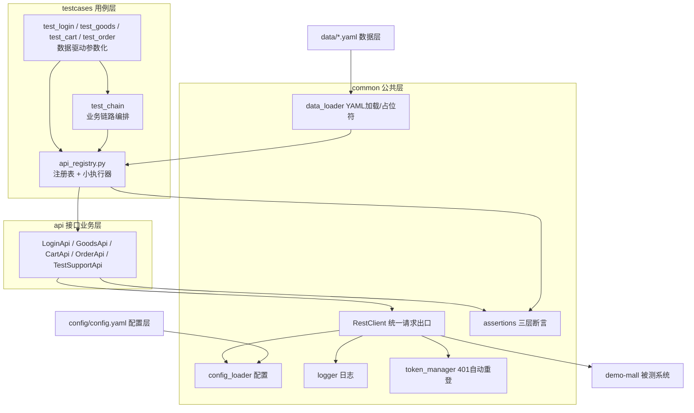

# api-test-framework · 接口自动化测试框架

> 针对 demo-mall 商城系统的接口自动化框架：**六层分层 + YAML 数据驱动 + 三层断言 + token 全自动关联 + Allure 报告**。
> 58 条用例一键运行约 1 秒，新增同接口用例零 Python 代码。

 <!-- 可选：自行截图替换 -->

## 架构总览



**分层铁律**：`testcases → api → common`，依赖只能向下；testcases 里不允许出现 URL 和 requests 调用。

## 快速启动（3 步）

```bash
# 0) 前置：被测系统
cd ../demo-mall && pip install -r requirements.txt && python seed.py --reset && python run.py

# 1) 安装依赖（本机已装可跳过）
pip install -r requirements.txt

# 2) 跑全部用例
python -m pytest                 # 58 passed
```

## 看 Allure 报告

```bash
# 需先安装 Allure 命令行（见 docs/10）
allure serve reports/allure-results
# 或生成静态站点后打开
allure generate reports/allure-results -o reports/allure-report --clean
allure open reports/allure-report
```

## 目录说明

| 目录/文件 | 职责 | 详解文档 |
|---|---|---|
| `config/config.yaml` | 环境配置：base_url、账号、超时、测试钥匙 | [docs/02](docs/02-配置管理.md) |
| `common/` | 配置加载、日志、RestClient、token、断言、数据加载 | [docs/03-05](docs/04-RestClient请求封装.md) |
| `api/` | 每个业务域一个类，URL 只出现在这里 | [docs/06](docs/06-接口业务层api.md) |
| `data/*.yaml` | 51 条单步用例 + 4 条链路用例的数据 | [docs/07](docs/07-YAML数据驱动.md) |
| `testcases/` | 用例文件 + conftest 装配 + 注册表执行器 | [docs/08-09](docs/08-pytest核心与conftest.md) |
| `reports/` | Allure 结果与报告、日志（gitignore） | [docs/10](docs/10-Allure报告与失败留痕.md) |

完整文档索引见 [docs/00-项目总览.md](docs/00-项目总览.md)。

## 用例统计

| 维度 | 数量 | 说明 |
|---|---|---|
| 用例总数 | **58** | `python -m pytest --collect-only -q` 可复核 |
| 覆盖接口 | **16** | auth×3 + goods×2 + cart×4 + orders×5 + test×2 |
| 正向:反向 | ≈ 7:3 | 反向覆盖参数校验/鉴权/状态机/边界 |
| 运行耗时 | ~1s | 本地 SQLite 被测系统 + Session 连接复用 |

## 常用命令

```bash
python -m pytest -m smoke                     # 只跑冒烟（-m 标记用例）
python -m pytest testcases/test_login.py -k "密码错误" -v
python -m pytest -p no:cacheprovider --co -q  # 只收集不执行
MALL_BASE_URL=http://127.0.0.1:5001 python -m pytest   # 临时换被测地址
MALL_LOG_LEVEL=DEBUG python -m pytest -k "登录"        # 打开报文级日志
```

## CI

GitHub Actions：`.github/workflows/ci.yml`（push 自动起被测系统跑回归）；
Jenkins：见 `../ci-cd/jenkins/Jenkinsfile`（定时回归 + Allure 报告 + 邮件）。

## 设计与教学文档

本仓库的 `docs/` 目录是完整的"怎么实现 + 为什么这样设计"逐模块讲解，
配合 `D:\软件测试\项目实战学习路线.md` 的 S1–S8 学习计划使用——
**先看文档理解，再自己从空目录复现，最后对照本仓库查缺补漏。**
