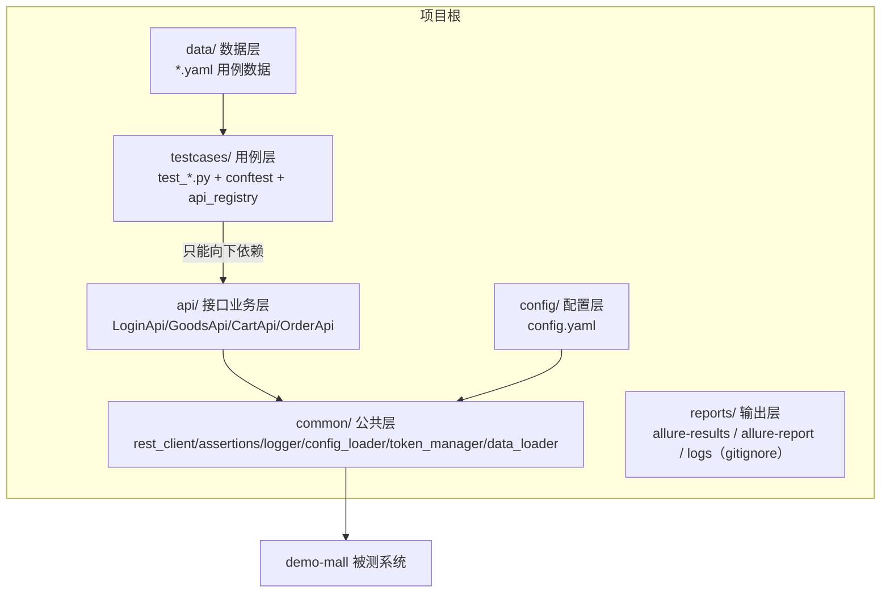

# 01 · 工程结构与六层分层（api-test-framework · 文档01）

> 一句话：目录结构就是架构——六个目录、一条依赖规则，把"脚本堆"变成"框架"。

## 1. 在整个框架中的位置

这是框架的"骨架"，其他所有模块都挂在这副骨架上。分层图：



## 2. 涉及文件

```
api-test-framework/
├── pytest.ini            # pytest 配置：目录、默认参数、marker
├── requirements.txt      # 依赖清单（面试官 clone 后第一眼看这里）
├── .gitignore            # reports/、缓存不入库
├── config/config.yaml
├── common/               # 6 个模块，见 docs/02-05
├── api/                  # 5 个业务域类 + BaseApi
├── data/                 # 5 个 YAML
├── testcases/            # conftest.py + api_registry.py + 5 个 test 文件
└── reports/              # 运行时产物
```

## 3. 如何实现

### 3.1 六层各自的职责边界（每层的"一句话岗位说明"）

| 层 | 只允许做 | 严禁出现 |
|---|---|---|
| config | 环境地址、账号、超时等"会变的数" | 业务逻辑、代码 |
| data | 用例的输入与期望 | Python 代码、URL |
| testcases | 调 api 层方法 + 断言 + 链路编排 | URL 字符串、requests 调用、登录细节 |
| api | URL、参数结构、一个业务域一个类 | 断言、print、数据文件读取 |
| common | HTTP 出口、断言库、日志、配置、token 策略 | 业务知识（不知道"商城"存在） |
| reports | 运行产物 | 入 git |

### 3.2 pytest 如何找到代码（导入机制）

所有含代码的目录都有 `__init__.py`（成为"包"）。pytest 从用例文件向上找
没有 `__init__.py` 的祖先目录 → 项目根被插入 `sys.path`，所以
`from common.rest_client import RestClient` 在任何机器、任何 cwd 下都能导入。
这也是"运行 pytest 必须在项目根"的原因（用 `cd` 到项目根再跑）。

### 3.3 pytest.ini

```ini
[pytest]
testpaths = testcases                # 只把 testcases/ 当用例目录
addopts = -v --alluredir=reports/allure-results --clean-alluredir --reruns 1 --reruns-delay 1
markers =
    smoke: 冒烟用例（快速验证核心链路）
```

- `--alluredir`：每次运行都产出 Allure 结果（S8 才讲报告，但配置一次到位）；
- `--clean-alluredir`：清掉上次结果，避免新旧混淆；
- `--reruns 1`：失败自动重跑 1 次（docs/11 讲"重试与真失败"的辩证关系）。

### 3.4 依赖方向如何被"物理"保证

Python 不会自动阻止你写 `common/xxx.py 里 import api.yyy`，靠两道防线：

1. **代码评审纪律**（本仓库注释里写明）；
2. **依赖倒置**：common 里确实需要"登录能力"的 TokenManager，用参数注入
   （`TokenManager(login_func=...)`），而不是 import api——见 docs/05。

## 4. 为什么这样设计

| 决策 | 备选方案 | 结论 |
|---|---|---|
| 按业务域拆 api 类（LoginApi/GoodsApi…） | 全部塞一个 api.py | 业务域拆分：文件小、定位快、多人协作不冲突；一个文件 2000 行是维护灾难 |
| testcases 与 data 分离 | 数据写在 .py 里 | 数据驱动的前提；YAML 可交给不懂代码的人维护（docs/07 详述） |
| reports 入 gitignore | 报告提交到 git | 报告是产物不是源码；CI 每次都会重新生成 |
| pytest.ini 而非 pyproject.toml | pyproject.toml | 教学\target是"少一层概念"；pytest.ini 单文件直白，以后要工程化再迁移 |

## 5. 怎么运行/验证

```bash
cd D:\软件测试\api-test-framework
python -m pytest --collect-only -q | tail -1     # 58 tests collected
python -m pytest -m smoke -v                     # marker 过滤（本仓库用例未打 smoke 标记时会 collect 到 0，属正常）
tree /f                                          # 看目录树（Windows）
```

预期：`--collect-only` 收集 58 条；目录结构与本文档一致。

## 6. 常见坑

1. **在错误目录跑 pytest**：在 demo-mall 目录跑会 `collected 0 items`——pytest 找的是当前目录的 testpaths。永远先 `cd api-test-framework`。
2. **忘了 `__init__.py`**：某个目录少了它，pytest 会把该目录本身加进 sys.path，导致 `import common` 报 ModuleNotFoundError 或双份导入怪问题。
3. **reports 忘了 gitignore**：Allure 结果一堆 json 被 commit 进 git，仓库瞬间臃肿——这是面试官一眼看出的"不专业"。
4. **tests 之间隐式依赖顺序却无文档**：本框架的顺序依赖（链路先跑、单步后跑）全部写进了数据文件和用例文件的注释里——无注释的顺序依赖是定时炸弹。

## 7. 面试怎么讲

**30 秒版**：
"框架采用六层分层：config 管环境、data 放用例数据、testcases 只做编排和断言、
api 层封装每个业务域的接口（URL 只出现在这一层）、common 提供请求/断言/日志等公共能力、
reports 是产物。依赖只能向下，接口变了只改 api 层，加用例只写 YAML。
这套结构让 58 条用例维护成本极低——这是我理解'脚本'和'框架'区别的核心。"

**高频追问**：
1. *"为什么 common 不能 import api？"* —— 会形成循环依赖（api 要用 RestClient，common 的 token 管理又要登录），
   且让公共层沾染业务、失去通用性；需要登录能力时用依赖倒置注入回调。
2. *"接口路径变了要改多少地方？"* —— 只改 api/ 层对应方法；数据驱动用例一条都不用动，这正是分层的价值。
3. *"为什么不用 unittest？"* —— pytest 的 fixture 依赖注入、parametrize 数据驱动、插件生态（allure/rerunfailures）
   和更简洁的 assert 风格，都直接命中接口自动化的核心痛点；unittest 的 setUp/tearDown 表达复杂依赖很吃力。

## 8. 复现任务清单

- [ ] 1. 从空目录建出 6 个目录 + `__init__.py` + pytest.ini + .gitignore + requirements.txt
- [ ] 2. 写 test_demo.py：两条最简单的 assert 用例，跑通 `pytest -v`
- [ ] 3. 配置 --alluredir 并确认 reports/allure-results 生成 json
- [ ] 4. git init + .gitignore 生效验证（reports/ 不出现在 git status）
- [ ] 5. 画出六层分层图并给每层写一句职责说明（口述给同学听）
- [ ] 6. 故意在 testcases 里写一个 requests 调用，体会"违反铁律"为什么难维护，然后删掉
