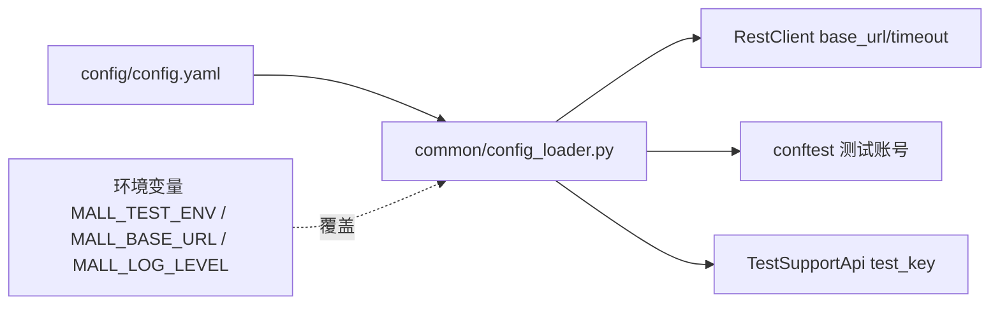

# 02 · 配置管理（api-test-framework · 文档02）

> 一句话：把"会变的数"（地址、账号、超时）从代码里抽出来，一处配置处处生效，换环境不改代码。

## 1. 在整个框架中的位置

config 是所有模块的"底座"：RestClient 用它取 base_url/超时，conftest 用它取账号，TestSupportApi 用它取测试钥匙。



## 2. 涉及文件

| 文件 | 职责 |
|---|---|
| `config/config.yaml` | 唯一的配置文件（dev 环境一个二级节点） |
| `common/config_loader.py` | 读文件 + 环境变量覆盖 + 全局单例 |

## 3. 如何实现

### 3.1 配置文件的结构

```yaml
default_env: dev          # 默认环境 key
dev:                      # 每个环境一个节点，字段结构必须一致
  base_url: http://127.0.0.1:5000
  timeout: 10
  test_key: mall-test-key
  users:
    main: { username: lemon, password: "123456" }
    alt:  { username: test,  password: "123456" }
log:
  level: INFO
  dir: reports/logs
```

两个 YAML 细节（新手最容易栽的坑）：

1. **密码必须加引号**：`password: "123456"`，否则 YAML 按数字解析成 `int 123456`，
   后面 `password.encode()` 直接 AttributeError；
2. **中文不用转义**：PyYAML 读写 UTF-8 原生支持，`open(..., encoding="utf-8")` 别忘。

### 3.2 Config 类（common/config_loader.py 核心逻辑）

```python
class Config:
    def __init__(self, path=None):
        data = yaml.safe_load(open(path, encoding="utf-8"))
        # ① 环境选择：环境变量优先，配置文件兜底
        self.env = os.environ.get("MALL_TEST_ENV") or data["default_env"]
        env_conf = data[self.env]
        # ② base_url 支持环境变量覆盖：CI 里换端口不用改文件
        self.base_url = (os.environ.get("MALL_BASE_URL") or env_conf["base_url"]).rstrip("/")
        self.timeout = env_conf.get("timeout", 10)
        self.users = env_conf.get("users", {})
        ...
```

### 3.3 单例入口

```python
def get_config() -> Config:
    global _config_instance
    if _config_instance is None:
        _config_instance = Config()
    return _config_instance
```

第一次调用读文件，之后全部走缓存——58 条用例共享同一份配置对象。

## 4. 为什么这样设计

| 决策 | 备选方案 | 结论 |
|---|---|---|
| YAML 配置 | .py 配置文件 / .ini / .env | 与用例数据同一种格式（团队只学一种语法）；注释友好；比 .ini 能表达嵌套（users） |
| 环境变量 > 配置文件 | 只靠配置文件 | CI 的惯例：环境差异用环境变量注入，代码/配置零修改 |
| 全局单例 get_config() | 每个 fixture 各读一遍 | 一致性（改配置不会一半用例生效一半不生效）+ 省重复 IO |
| `rstrip("/")` 处理 base_url | 信任配置 | 有人在配置里写 `http://x:5000/`，拼出 `//api/goods` 就是 404——防御性编程 |

**为什么没做"加密敏感信息"**：这是本地教学项目，secret 全是演示值；真实项目用
环境变量/凭据管理（Jenkins Credentials、Vault）。文档里写明，面试答到这个层次就够了。

## 5. 怎么运行/验证

```bash
cd D:\软件测试\api-test-framework
python -c "from common.config_loader import get_config; c=get_config(); print(c.base_url, c.users['main'])"
# 预期: http://127.0.0.1:5000 {'username': 'lemon', 'password': '123456'}

MALL_BASE_URL=http://127.0.0.1:9999 python -c "from common.config_loader import get_config; print(get_config().base_url)"
# 预期: http://127.0.0.1:9999   （环境变量覆盖生效）
```

## 6. 常见坑

1. **密码没加引号** → YAML 解析成 int → `int.encode()` 报 AttributeError，且报错位置在 api 层离配置十万八千里。
2. **Windows 换行/编码**：config.yaml 必须 UTF-8；用记事本编辑保存成 GBK 会直接 UnicodeDecodeError。用 VSCode 编辑。
3. **环境名写错**：`MALL_TEST_ENV=DEV`（大写）找不到 `DEV` 节点——本框架直接 raise KeyError 列出可用环境，这是刻意的快速失败设计。
4. **把配置读散**：在某个用例里直接 `yaml.safe_load(open("config.yaml"))` 读配置 = 绕过单例，改配置后行为不一致。一律走 `get_config()`。

## 7. 面试怎么讲

**30 秒版**：
"配置独立成层，YAML 按环境分节点，common 提供全局单例加载器；
base_url 和日志级别支持环境变量覆盖，所以 CI 换环境零代码改动。
配置里最容易踩的坑是 YAML 类型推断——密码不加引号会变成 int，这是我们用真实报错换来的经验。"

**高频追问**：
1. *"多环境怎么切换？"* —— `MALL_TEST_ENV=prod python -m pytest`，配置里加 prod 节点即可；环境变量优先于 default_env。
2. *"账号密码明文放配置安全吗？"* —— 教学项目可以；真实项目密码进 CI 凭据管理（Jenkins Credentials HashiCorp Vault），配置文件只留引用。
3. *"为什么配置不用 py 文件？"* —— py 文件"配置即代码"容易被顺手写逻辑；YAML 纯数据、可读性对非开发友好、和用例数据格式统一。

## 8. 复现任务清单

- [ ] 1. 写 config/config.yaml：base_url、timeout、两个测试账号、log 配置
- [ ] 2. 写 common/config_loader.py：Config 类 + get_config() 单例 + 环境变量覆盖
- [ ] 3. 验证：故意把密码引号去掉，观察报错；再加回来
- [ ] 4. 验证：`MALL_BASE_URL` 环境变量覆盖 base_url 生效
- [ ] 5. 思考题：如果要加"预发环境 pre"，需要改几个文件？（答案：只改 config.yaml，加一个节点）
