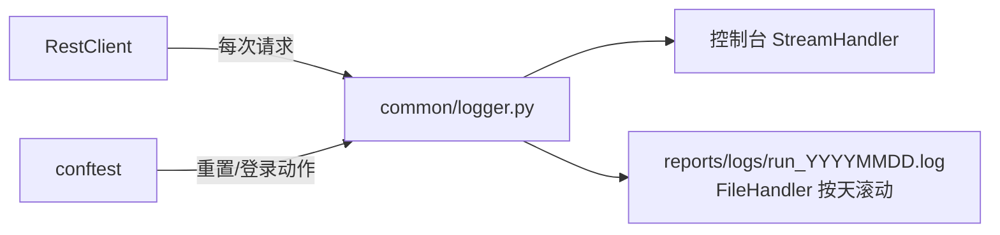

# 03 · 日志系统（api-test-framework · 文档03）

> 一句话：控制台看进度、文件留证据——接口失败排查的"第一现场"永远可回放。

## 1. 在整个框架中的位置



## 2. 涉及文件

| 文件 | 职责 |
|---|---|
| `common/logger.py` | get_logger 工厂：格式、双 handler、级别 |
| `common/rest_client.py` | 请求/响应日志的"生产者"（INFO 记动作，DEBUG 记报文） |
| `reports/logs/` | 运行产物（gitignore） |

## 3. 如何实现

### 3.1 get_logger 的三个关键机制

```python
def get_logger(name: str = "api-test") -> logging.Logger:
    logger = logging.getLogger(name)
    if logger.handlers:            # ① 幂等：已初始化直接返回
        return logger

    cfg = get_config()
    os.makedirs(cfg.log_dir, exist_ok=True)
    log_file = os.path.join(cfg.log_dir, f"run_{datetime.now():%Y%m%d}.log")   # ② 按天一个文件

    file_handler = logging.FileHandler(log_file, encoding="utf-8")
    console_handler = logging.StreamHandler()
    ...两处 setFormatter(FORMAT)...

    logger.setLevel(cfg.log_level)     # ③ 级别来自配置（可被 MALL_LOG_LEVEL 覆盖）
    logger.addHandler(file_handler)
    logger.addHandler(console_handler)
    logger.propagate = False           # ④ 阻断向 root logger 冒泡，防止 pytest 再打印一遍
    return logger
```

- **① 幂等**：Python 的 logger 是全局单例，重复 addHandler 会打印两遍——这是新手最高频的坑；
- **② 按天滚动**：文件名带日期，"昨晚 Jenkins 的回归"回看时直接找当天的文件；
  （企业更常用 `logging.handlers.TimedRotatingFileHandler` 自动轮转，教学版用日期命名等价且更直观）
- **④ propagate=False**：pytest 会捕获 root logger 再输出一次，不关冒泡就双份。

### 3.2 分级策略（谁记什么级别）

| 级别 | 内容 | 示例 |
|---|---|---|
| INFO | 每个请求一行：方法、路径、参数、状态码、耗时 | `-> POST /api/auth/login params=None body={...}` `<- HTTP 200 (8ms)` |
| DEBUG | 完整请求头（含 token）、完整响应体 | 排查鉴权/报文问题才开 |
| WARNING | 401 触发自动重登 | `收到 401，尝试自动重新登录并重放` |
| ERROR | 网络层失败（连接拒绝/超时） | `请求失败: ... Connection refused` |

查看完整报文：`MALL_LOG_LEVEL=DEBUG python -m pytest -k "登录"`。

### 3.3 日志里记了什么"证据"

一次失败请求在日志里长这样（报文已脱敏截断）：

```
2026-10-25 05:13:27 [INFO] rest_client - -> GET /api/goods/1 params=None body=None
2026-10-25 05:13:27 [INFO] rest_client - <- HTTP 200 (2ms) /api/goods/1
```

配合 docs/07 的"断言失败打印请求响应全文"，做到**看报错即定位，不重跑**。

## 4. 为什么这样设计

| 决策 | 备选方案 | 结论 |
|---|---|---|
| 自写 get_logger（40 行） | loguru / logging.dictConfig | 标准库零依赖、机制透明可讲解；企业里两者都有，原理一致 |
| INFO 记"动作"、DEBUG 记"报文" | 全部 INFO 打报文 | 控制台不被刷屏；报文量大（含 token），按需开启 |
| 请求日志写在 RestClient | 散在各 api 方法 | 统一出口 = 统一日志，一处写全框架生效（分层红利） |
| 文件按天命名 | 单文件追加 | Jenkins 每晚跑、本地反复跑，按天切分好定位 |

**为什么不用 print**：print 无级别、无文件、无时间戳，且 pytest 会捕获输出——
日志是"可配置的基础设施"，print 是"一次性调试"。

## 5. 怎么运行/验证

```bash
cd D:\软件测试\api-test-framework
python -m pytest -k "登录" > /dev/null 2>&1; ls reports/logs/
# 预期: run_20261025.log（当天日期）

grep "POST /api/auth/login" reports/logs/run_*.log | head -2
# 预期: 两行：-> 请求行 与 <- 响应行
```

## 6. 常见坑

1. **日志打印两遍**：忘了 `propagate=False` 或在多个模块重复 addHandler。
2. **FileHandler 中文乱码**：没传 `encoding="utf-8"`，Windows 默认 GBK。
3. **日志文件进了 git**：logs/ 目录要进 .gitignore。
4. **在 api 层 print 调试后忘了删**：print 输出会被 pytest 捕获进报告，污染 Allure——统一用 logger。

## 7. 面试怎么讲

**30 秒版**：
"日志我做了三件事：双 handler（控制台+按天滚动文件）、分级（INFO 记请求动作、
DEBUG 才记完整报文）、幂等的 get_logger 工厂。日志统一埋在 RestClient 出口——
所有请求天然留痕，失败时配合断言失败信息，看报错就能定位，不用重跑抓包。"

**高频追问**：
1. *"日志怎么和 Allure 结合？"* —— 断言失败信息完整进用例的 failure message（报告直接显示），
   响应报文另用 allure.attach 挂附件（docs/10）。
2. *"敏感信息怎么处理？"* —— 生产实践对 token/密码脱敏（只留前 8 位）；教学框架在 DEBUG 级别明文，INFO 不含敏感字段。
3. *"日志会不会拖慢执行？"* —— 正常用例只打两行 INFO，微秒级；DEBUG 级别的字符串格式化用 %s 惰性求值，级别不够时连拼接都不发生。

## 8. 复现任务清单

- [ ] 1. 写 get_logger：双 handler + 按天文件 + 幂等保护 + propagate=False
- [ ] 2. 在 RestClient 里埋 INFO 日志（请求行/响应行）与 DEBUG 日志（报文）
- [ ] 3. 跑一条用例，验证日志文件生成且控制台无双份
- [ ] 4. 把日志级别调成 DEBUG，确认能看到完整响应体
- [ ] 5. 思考题：为什么请求日志放在 RestClient 而不是每个 api 方法里？（答案：唯一出口，一处埋点全框架生效）
