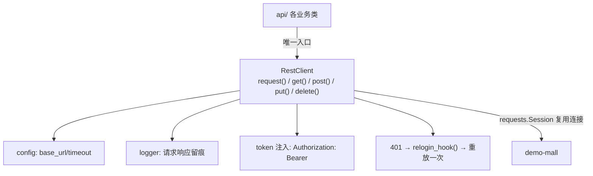

# 04 · RestClient 请求封装（api-test-framework · 文档04）

> 一句话：全框架唯一的 HTTP 出口——统一 base_url、超时、token 注入、日志、异常翻译和 401 重试策略。

## 1. 在整个框架中的位置



## 2. 涉及文件

| 文件 | 职责 |
|---|---|
| `common/rest_client.py` | RestClient 类 + ApiError 异常 |
| `api/*.py` | 调用方（业务方法内部全是 `self.client.post(...)`） |

## 3. 如何实现

### 3.1 核心方法 request() 的完整流程

```python
def request(self, method, path, params=None, json_body=None,
            headers=None, _auth_retry=True) -> requests.Response:
    url = self.base_url + path
    req_headers = {"Accept": "application/json"}
    if self.token:                                        # ① token 自动注入
        req_headers["Authorization"] = f"Bearer {self.token}"
    if headers:
        req_headers.update(headers)                       # ② 调用方显式头可覆盖

    log.info("-> %s %s params=%s body=%s", method, path, params, ...)
    try:
        resp = self.session.request(method, url, params=params, json=json_body,
                                    headers=req_headers, timeout=self.timeout)
    except requests.RequestException as exc:              # ③ 网络异常翻译
        raise ApiError(f"请求 {method} {url} 失败：{exc}") from exc

    log.info("<- HTTP %s (%.0fms) %s", resp.status_code, cost_ms, path)

    # ④ 401 自动重登并重放一次
    if resp.status_code == 401 and _auth_retry and self.relogin_hook:
        new_token = self.relogin_hook()
        if new_token:
            self.set_token(new_token)
            return self.request(..., _auth_retry=False)   # 只重放一次，防无限递归
    return resp
```

四个关键点逐个拆：

- **① token 注入点**：api 层方法从不碰 token——client 有 token 就自动带。用例层因此
  完全不用关心鉴权（S7 的"token 自动关联"就落在这两行）；
- **② `json=` 参数**：requests 的 `json=` 自动序列化 dict 并设置 `Content-Type: application/json`；
  用 `data=` 发 dict 则是 form 编码——混用是 415/400 的头号来源（S2 的经典坑）；
- **③ ApiError**：连接拒绝/超时这类"根本没到服务器"的错误，翻译成带 URL 上下文的异常。
  它和"业务失败"（HTTP 200 + code≠0）是两回事：前者是环境问题，后者是被测系统行为；
- **④ 重放保护**：`_auth_retry=False` 保证最多重放一次——若账号本身坏了，第二次 401
  原样返回，避免无限循环重登。

### 3.2 Session 的作用

```python
self.session = requests.Session()
```

- **连接复用**：HTTP keep-alive，58 条用例共享 TCP 连接池，套件耗时明显下降；
- **为什么不用模块级 requests.post()**：每次调用都是新连接，且全局状态（如 cookie）难管理。

### 3.3 语义化快捷方法

```python
def get(self, path, params=None, headers=None):    return self.request("GET", ...)
def post(self, path, json_body=None, ...):         return self.request("POST", ...)
```

api 层调用读起来像人话：`self.client.post("/api/orders", json_body=body)`。

### 3.4 返回值设计：返回原始 Response

api 层方法返回 `requests.Response`（不是解析后的 dict），因为三层断言
同时需要 `status_code` 和 `json()`——"解析权"交给断言层（docs/07）。

## 4. 为什么这样设计

| 决策 | 备选方案 | 结论 |
|---|---|---|
| 统一 RestClient | 用例里直接 requests.post | 环境切换、日志、token、超时全都散落 = 维护灾难；封装是"框架"二字的第一块基石 |
| 401 重试用钩子注入 | RestClient 里直接调 LoginApi | common 不许依赖 api（循环依赖）；钩子由 conftest 注入（依赖倒置），RestClient 保持通用 |
| 返回 Response 而非 dict | 返回 resp.json() | 断言要同时看状态码和 body；且失败时能打出原始报文 |
| ApiError 与业务失败分离 | 统一抛一个异常 | 环境挂了要"报错即停"，业务失败要"断言裁决"——混在一起用例结果不可信 |

**企业同款**：httprunner、各大厂的接口框架第一步都是封装一个"统一请求出口"，思路完全一致。

## 5. 怎么运行/验证

```bash
cd D:\软件测试\api-test-framework
python -c "
from common.rest_client import RestClient
c = RestClient()
r = c.get('/api/health')
print(r.status_code, r.json()['data'])
"
# 预期: 200 {'status': 'up'}

# 验证 ApiError（被测系统没启动时）：
python -c "
from common.rest_client import RestClient
c = RestClient('http://127.0.0.1:59999')
c.get('/api/health')
" 2>&1 | tail -1
# 预期: common.rest_client.ApiError: 请求 GET http://127.0.0.1:59999/api/health 失败：...
```

## 6. 常见坑

1. **`json=` 与 `data=` 混用**：`data={"a":1}` 发的是 form 表单，服务端 `request.get_json()` 拿不到 → 415/1004。本项目统一 `json=`。
2. **忘 rstrip base_url**：配置末尾多个 `/` 拼出 `//api/goods`。
3. **timeout 不设**：被测系统卡死时用例挂起整个 CI。本项目 10s 超时 + 明确报错。
4. **401 无限重登**：重登逻辑没做"只重放一次"保护，账号坏掉时会把 CI 拖死。
5. **token 过期没兜底**：长套件跑到一半 token 过期，后半场全挂——这正是钩子存在的理由。

## 7. 面试怎么讲

**30 秒版**：
"我把所有 HTTP 请求收敛到一个 RestClient：统一 base_url 和超时、token 自动注入、
请求响应全量日志、网络异常翻译成带上下文的 ApiError，401 时通过注入的钩子自动重登并重放一次。
上层 api 类只负责业务语义，完全感知不到这些横切逻辑——改被测环境或换鉴权方式，只动这一个类。"

**高频追问**：
1. *"requests.Session 有什么好处？"* —— TCP 连接复用（keep-alive）+ 会话级状态管理，批量请求快很多。
2. *"401 重试为什么只重放一次？"* —— 防止账号配置错误导致无限重登循环；一次足矣区分"token 过期"和"账号坏"。
3. *"怎么支持多环境并发跑？"* —— RestClient 实例是隔离的（各自持有 base_url/token），多实例即可；但注意用例数据有服务端状态，并行要先做数据隔离（pytest-xdist 的事，教学版先串行）。

## 8. 复现任务清单

- [ ] 1. 写 ApiError + RestClient 骨架（__init__ 持有 Session/base_url/timeout/token）
- [ ] 2. 实现 request()：头合并、token 注入、日志、异常翻译
- [ ] 3. 实现 401 钩子重放（带 _auth_retry 保护），先不接真登录，hook 里返回 None 验证不循环
- [ ] 4. 补 get/post/put/delete 快捷方法
- [ ] 5. 验证：health 接口通；拔掉被测系统跑一次，看 ApiError 报错是否一眼能懂
