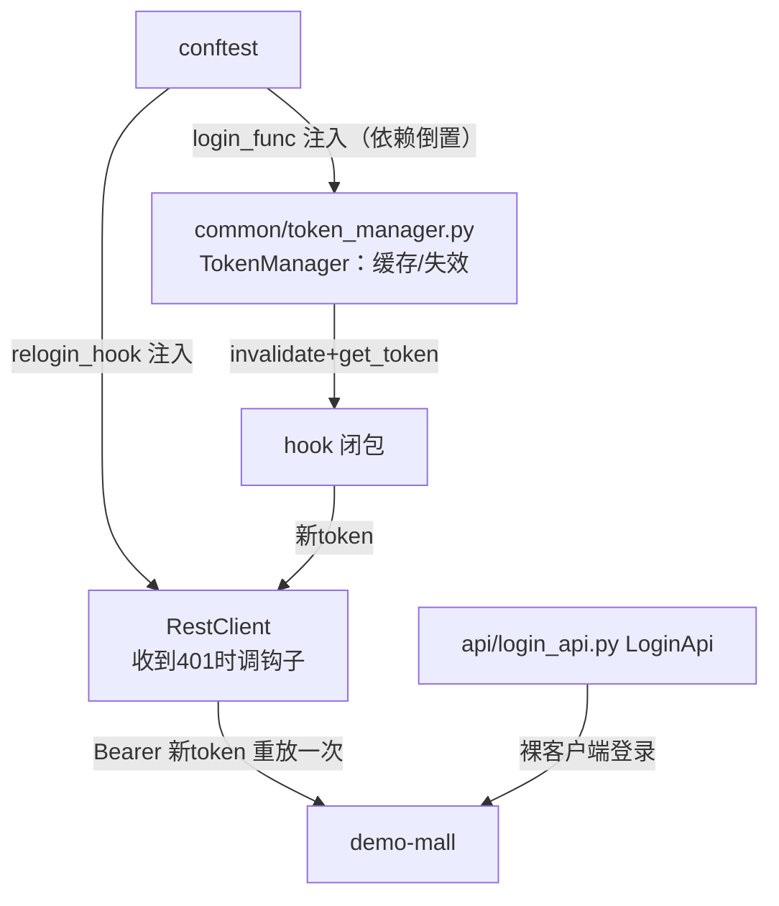

# 05 · Token 管理与 401 自动重登（api-test-framework · 文档05）

> 一句话：一次登录全程复用；token 失效自动重登并重放请求——鉴权自动化 This is the 面试最常被追问的机制。

## 1. 在整个框架中的位置



## 2. 涉及文件

| 文件 | 职责 |
|---|---|
| `common/token_manager.py` | TokenManager：按账号缓存 token、可失效 |
| `testcases/conftest.py` | `_make_login_func()`、三个客户端 fixture 的装配 |
| `common/rest_client.py` | 401 时调用 relogin_hook 并重放（见 docs/04） |
| `api/test_support_api.py` | 调被测系统的 revoke-token 接口（制造真实 401） |

## 3. 如何实现

### 3.1 TokenManager（缓存与刷新策略）

```python
class TokenManager:
    def __init__(self, login_func):
        self._login_func = login_func      # 外部注入的登录函数
        self._cache: dict[str, str] = {}

    def get_token(self, user_key="main") -> str:
        if user_key not in self._cache:
            self._cache[user_key] = self._login_func(user_key)["token"]
        return self._cache[user_key]

    def invalidate(self, user_key="main"):
        self._cache.pop(user_key, None)
```

它只知道"登录函数"这个抽象，不知道登录接口长什么样——所以 common 不 import api。

### 3.2 conftest 的装配（重点看依赖注入）

```python
def _make_login_func():
    cfg = get_config()
    bare_client = RestClient(cfg.base_url, cfg.timeout)   # 裸客户端：登录专用

    def login_func(user_key):
        user = cfg.users[user_key]
        resp = LoginApi(bare_client).login(user["username"], user["password"])
        if resp.status_code != 200 or resp.json().get("code") != 0:
            raise RuntimeError(f"自动登录失败...请确认被测系统已启动")
        return resp.json()["data"]
    return login_func


@pytest.fixture(scope="session")
def rest_client(token_manager):
    def relogin_hook():
        token_manager.invalidate("main")       # 先作废缓存（旧token已失效）
        return token_manager.get_token("main") # 再重新登录

    client = RestClient(cfg.base_url, cfg.timeout, relogin_hook=relogin_hook)
    client.set_token(token_manager.get_token("main"))    # session 开始登录一次
    return client
```

数据流串起来：

1. session 开始 → `rest_client` 登录一次，token 进缓存并注入 client；
2. 58 条用例复用同一个 client → 全程**一次登录**；
3. 某请求返回 401 → RestClient 调 `relogin_hook` → 缓存作废 + 重新登录 → 新 token 注入 → **原请求自动重放一次** → 用例无感知通过。

### 3.3 三个客户端 fixture 的分工

| fixture | token | 钩子 | 用途 |
|---|---|---|---|
| `rest_client` | 有（main） | 有 | 绝大多数单步用例 |
| `fresh_client` | 无 | 无 | 未登录反向用例（401 要原样返回，不能被钩子"救活"） |
| `chain_client` | 初始无，链路登录后注入 | 有 | 链路用例（会切账号/吊销 token，与主会话隔离） |

### 3.4 验证机制的真实用例（chain_data.yaml）

```yaml
- name: token被吊销后自动重登重放
  steps:
    - name: 登录主账号
      api: login
      extract: { token: $.data.token }
    - name: 调用测试接口吊销该token        # 被测系统的"测试后门"，制造真实失效
      api: test_revoke
      params: { token: "{{token}}" }
    - name: 用已吊销token查询购物车         # 服务端返 401 → 钩子重登 → 重放 → code 0
      api: cart_get
      expect: { code: 0 }
```

## 4. 为什么这样设计

| 决策 | 备选方案 | 结论 |
|---|---|---|
| session 级缓存 token | 每条用例都登录 | 慢 58 倍登录开销 + 给被测系统无谓压力；企业框架必缓存 |
| 钩子注入而非直接调用 | TokenManager 里 import RestClient+LoginApi | 循环依赖 + common 沾业务；注入后 TokenManager 可单测 |
| 401 才触发重登 | 每个请求前校验 token 有效期 | 客户端算不准服务端语义（吊销/时区）；401 是唯一权威信号 |
| fresh_client 不带钩子 | 全部带钩子 | "未登录"反向用例期望 401，钩子会把失败"救活"成假通过——**反向用例绝不能被自动化机制掩盖** |
| 链路用独立 client | 共用 rest_client | 链路切账号/吊销 token 会污染主会话，导致后续单步用例身份错乱（开发中真实踩过：me 断言 username 变成 test） |

**token/session/JWT 追问的底层**：本框架的 token 是 JWT（服务端无状态，靠签名+exp 校验）；
demo-mall 的 revoke 用内存黑名单模拟"服务端可控失效"——面试讲清"JWT 天然不可主动失效，
所以才有黑名单/短过期+刷新"这套组合拳。

## 5. 怎么运行/验证

```bash
cd D:\软件测试\api-test-framework
# ① 看自动重登全过程（日志里能看到 401 → 重登 → 重放）：
python -m pytest "testcases/test_chain.py" -k "吊销" -v --reruns 0 2>&1 | grep -E "401|重登|passed"
# 预期: WARNING ... 收到 401，尝试自动重新登录并重放 ... 1 passed

# ② 验证 session 只登录一次：数日志里 login 调用次数
python -m pytest 2>&1 | tail -1
grep -c "自动登录账号" reports/logs/run_$(date +%Y%m%d).log
# 预期: 个位数（远小于用例数 58）
```

## 6. 常见坑

1. **钩子里忘 invalidate**：缓存里还是旧 token，get_token 原样返回 → 重放还是 401。
2. **无保护重放**：401→重登→401→重登… 死循环打爆被测系统。`_auth_retry=False` 是保命符。
3. **fixture 作用域用错**：登录 fixture 写成 function 级 → 每条用例登录一次（S4 的经典坑，验证方法见上面 grep 计数）。
4. **反向用例被钩子污染**：fresh_client 带了钩子，"无 token"用例永远过不了 401 断言。
5. **并行执行 token 互踩**：pytest-xdist 下多 worker 共享服务端状态，token/购物车数据互踩——先串行跑通，数据隔离是进阶课题。

## 7. 面试怎么讲

**30 秒版**：
"token 我做了两层自动化：**缓存复用**——session 级 fixture 登录一次，58 条用例共享，
不用每条都登录；**失效自愈**——RestClient 收到 401 时调用注入的钩子：作废缓存、重新登录、
新 token 注入后把原请求**自动重放一次**，用例完全无感知。重放有且仅有一次，
防止账号坏掉时死循环。为了让它被真实验证，我让被测系统提供了吊销 token 的测试接口，
专门有一条链路用例走'吊销→401→自动重登→成功'的全程。"

**高频追问**：
1. *"token 过期和无效怎么区分处理？"* —— 客户端不猜（exp 是本地时钟可能不准），统一 401 触发重登；吊销与过期对框架无区别。
2. *"JWT 和 session 的区别？"* —— session 状态在服务端（可主动踢人），JWT 状态在 token 里（无状态、天然可扩展，但失效要靠短过期+黑名单）。demo-mall 是 JWT+内存黑名单。
3. *"401 和 403 区别？"* —— 401 未认证（你是谁没确认，可重新登录），403 已认证但无权限（重登也没用）。
4. *"为什么用 fixture 而不是 setUpClass？"* —— fixture 支持作用域（session/module/function）、yield teardown、依赖注入和 conftest 跨文件共享，依赖关系声明式可组合；setUpClass 只能类级继承，表达不了"链路 client 依赖 token manager"这种图状依赖。

## 8. 复现任务清单

- [ ] 1. 写 TokenManager（缓存+invalidate），不 import 任何 api 模块
- [ ] 2. conftest 写 _make_login_func（裸客户端登录，失败给清晰报错）
- [ ] 3. 装配 rest_client：session 级 + 钩子 + 首次注入
- [ ] 4. RestClient 实现 401 重放（_auth_retry 保护）
- [ ] 5. 写 fresh_client（无钩子）并验证未登录用例 401 原样返回
- [ ] 6. 被测系统加 revoke-token 测试接口，写链路用例验证全流程
- [ ] 7. 数日志验证整个套件只登录了少数几次
