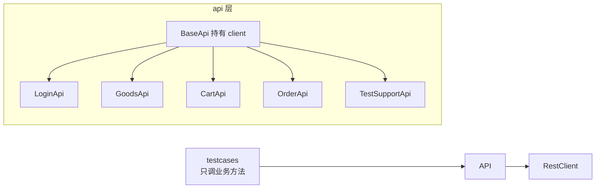

# 06 · 接口业务层 api/（api-test-framework · 文档06）

> 一句话：每个业务域一个类，URL 和参数结构只活在这一层——用例层调用它像说人话。

## 1. 在整个框架中的位置



## 2. 涉及文件

| 文件 | 业务域 | 方法数 |
|---|---|---|
| `api/base_api.py` | 基类：持有 RestClient | - |
| `api/login_api.py` | 登录/注册/个人信息 | 4 |
| `api/goods_api.py` | 商品列表/详情 | 2 |
| `api/cart_api.py` | 购物车查/加/改/删 | 4 |
| `api/order_api.py` | 订单创建/列表/详情/支付/取消 | 5 |
| `api/test_support_api.py` | 测试辅助（重置数据/吊销 token） | 2 |

## 3. 如何实现

### 3.1 基类

```python
class BaseApi:
    def __init__(self, client):
        self.client = client     # RestClient 实例，token 已由上层注入
```

### 3.2 典型方法：直购下单

```python
def create_order(self, items=None, from_cart=None):
    """POST /api/orders
    items=[{"goods_id":1,"quantity":2}] 直购 / from_cart=true 购物车结算。
    失败: 3001 购物车空 / 2001 商品不存在 / 2002 库存不足 / 1004 参数
    """
    body = {}
    if items is not None:
        body["items"] = items
    if from_cart is not None:
        body["from_cart"] = from_cart
    return self.client.post("/api/orders", json_body=body or None)
```

三个细节：

1. **docstring 就是接口文档**：路径、参数、成功/失败码全写在这——读用例的人不用翻接口文档；
2. **参数 None 时从 body 剔除**：这是给数据驱动反向用例用的——YAML 里不写某参数，
   请求体里就真的没有它（测"缺少参数"必须真的缺，而不是传 null）；
3. **返回原始 Response**：不在这里 .json()，解析权归断言层（docs/07）。

### 3.3 路径参数拼接

```python
def goods_detail(self, goods_id: int):
    return self.client.get(f"/api/goods/{goods_id}")
```

f-string 拼 RESTful 路径参数；query 参数交给 `params=`（requests 负责编码，中文关键字不用手动 urlencode）。

### 3.4 业务域类怎么被复用：注册表

YAML 用例只写 `api: login`，`testcases/api_registry.py` 里映射：

```python
REGISTRY = {
    "login":        lambda c, p: LoginApi(c).login(**p),
    "goods_detail": lambda c, p: GoodsApi(c).goods_detail(**p),
    ...
}
```

新增接口 = api 层加方法 + 注册表加一行；新增用例 = 只写 YAML（docs/07）。

## 4. 为什么这样设计

| 决策 | 备选方案 | 结论 |
|---|---|---|
| 按业务域拆类 | 按请求方法拆（GetApi/PostApi） | 业务域与需求、测试用例的组织方式同构；按方法拆找不到"购物车相关的接口都在哪" |
| api 层不做断言 | 在 api 方法里顺带断言 | 一个接口多种期望（正向/反向），断言权在用例；api 层有断言会让反向用例没法写 |
| docstring 记接口契约 | 依赖外部接口文档 | 代码即文档，IDE 悬浮可见；外部文档常常过期 |
| URL 只出现一次 | 用例里现写 URL | 接口路径变更时只改一处；grep 一下就知道全系统有多少处依赖 |

**"一个 GET 也包三层？"**——不过度封装的判断标准：如果方法只是
`self.client.get(url)` 一行且无参数语义要表达，直接用 client 也可以；
但只要涉及参数组装规则（如 list_goods 的分页/过滤），就值得进 api 层。分层的度由"是否消除重复/表达语义"决定。

## 5. 怎么运行/验证

```bash
cd D:\软件测试\api-test-framework
python -c "
from common.rest_client import RestClient
from api.goods_api import GoodsApi
resp = GoodsApi(RestClient()).list_goods(keyword='耳机')
data = resp.json()['data']
print(data['total'], data['list'][0]['name'])
"
# 预期: 1 无线蓝牙耳机
```

## 6. 常见坑

1. **在 api 层写断言/print**：反向用例没法写；print 污染报告。
2. **参数默认值用可变对象**：`def f(items=[])` 是 Python 经典陷阱（默认列表被所有调用共享），本项目用 None + 内部构造。
3. **漏掉"剔除 None"**：反向用例传 `{"quantity": None}` 而不是"没有 quantity"，服务端两种行为的处理可能不同（缺字段 vs null 字段），测的就不是同一件事。
4. **api 类之间互相引用**：CartApi import OrderApi——业务域之间通过用例层编排，不横向耦合。

## 7. 面试怎么讲

**30 秒版**：
"api 层按业务域组织：登录、商品、购物车、订单各一个类，继承 BaseApi 持有 RestClient。
它只做三件事：声明接口路径、组装参数、返回原始响应——不做断言。
参数为 None 时从请求体剔除，专门服务'缺少参数'的反向用例。
这一层的存在让'接口路径变了改哪里'的答案是唯一确定的：只改 api 层。"

**高频追问**：
1. *"PO 和 api 层封装的区别？"* —— 同一个思想（把'怎么访问系统'与'测什么'分离）用在两个维度：接口维度叫 api 层封装，页面维度叫 Page Object。
2. *"为什么用例层不直接拼 URL？"* —— URL 散落各处时，接口变更需要全库搜索修改，且容易出现不同用例写法不一致的笔误。
3. *"怎么给 api 方法写单测？"* —— mock RestClient（注入 fake client），验证参数组装逻辑；本项目依赖注入的设计让这变得自然。

## 8. 复现任务清单

- [ ] 1. 写 BaseApi（3 行）并理解它为什么存在
- [ ] 2. 实现 LoginApi：login/register/me/me_with_token，参数 None 剔除
- [ ] 3. 实现 GoodsApi/CartApi/OrderApi，每个方法带完整 docstring（路径/参数/业务码）
- [ ] 4. 实现 TestSupportApi（X-Test-Key 头从配置读取）
- [ ] 5. 验证：用 3 行 Python 调 GoodsApi 完成一次真实查询
- [ ] 6. 反思题：如果被测系统从 demo-mall 换成 RuoYi，哪个目录必须重写？（api/）哪个不用动？（common/、data/ 的格式、testcases/ 的执行器）
