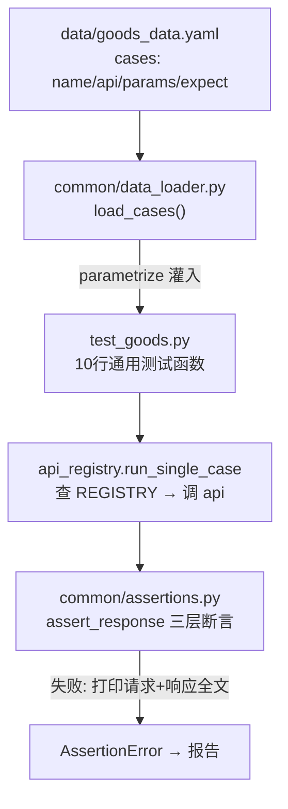

# 07 · YAML 数据驱动与三层断言（api-test-framework · 文档07）

> 一句话：加一条用例只写 YAML 不写 Python；断言分三层，失败信息自带"请求+响应全文"。

## 1. 在整个框架中的位置

数据层（data/*.yaml）+ 断言库（common/assertions.py）+ 执行器（testcases/api_registry.py）
三者合起来构成"数据驱动"闭环：



## 2. 涉及文件

| 文件 | 职责 |
|---|---|
| `data/*.yaml` | 51 条单步用例数据 + 4 条链路用例数据 |
| `common/data_loader.py` | load_cases() + substitute() 占位符替换 |
| `common/assertions.py` | 三层断言 + extract_jsonpath |
| `testcases/api_registry.py` | REGISTRY 注册表 + 执行器 |

## 3. 如何实现

### 3.1 用例数据的格式契约

```yaml
cases:
  - name: 关键字命中一件商品          # Allure 标题，报告可读性
    api: goods_list                   # 注册表里的接口名（不是 URL！）
    params: { keyword: 耳机 }         # 传给 api 方法的参数
    no_auth: true                     # 可选：换干净客户端（未登录场景）
    expect:
      status_code: 200                # ① HTTP 层
      code: 0                         # ② 业务层
      fields:                         # ③ 数据层（JSONPath → 期望值）
        $.data.total: 1
        $.data.list[0].name: 无线蓝牙耳机
```

**每个字段都有存在理由**：name 进报告、api 查注册表、params 进请求、
expect 是断言合同；no_auth 是反向用例的开关。约定即文档。

### 3.2 load_cases + parametrize（数据如何变成用例）

```python
# test_goods.py（全文件就这么多）
@pytest.mark.parametrize("case", load_cases("goods_data.yaml"), ids=lambda c: c["name"])
def test_goods_api(self, case, rest_client, fresh_client):
    client = fresh_client if case.get("no_auth") else rest_client
    run_single_case(case, client, context=case["name"])
```

- `ids=lambda c: c["name"]`：用例 ID 用中文名（报告里显示"关键字命中一件商品"，
  而不是 case0/case1）；
- parametrize 会把列表里每个元素实例化成**独立用例**——所以 pytest 统计 58 条，
  简历上的用例数就是它，真实可查（`pytest --collect-only -q`）。

### 3.3 执行器：run_single_case

```python
def run_single_case(case, client, context=""):
    allure.dynamic.title(case["name"])          # 报告标题 = 用例名
    func = REGISTRY[case["api"]]                # 名字 → api 层方法
    resp = func(client, substitute(case.get("params") or {}, {}))
    allure.attach(resp.text, name="响应报文", ...)   # 每条用例的响应进报告
    assert_response(resp, case.get("expect"), context=case["name"])
```

### 3.4 三层断言的实现

```python
def assert_response(resp, expect=None, context=""):
    body = resp.json() if 能解析 else None

    if "status_code" in expect:                      # ① HTTP 状态码
        _check(resp, "HTTP状态码", expect["status_code"], resp.status_code, ...)

    if "code" in expect:                             # ② 业务 code
        _check(resp, "业务code", expect["code"], body.get("code"), ...)

    for expr, expected in expect.get("fields", {}).items():   # ③ JSONPath 字段
        actual = extract_jsonpath(body, expr)
        if actual is None:
            _raise_fail(..., "JSONPath 未命中")
        _check(resp, f"字段 {expr}", expected, actual, ...)
```

**为什么必须三层**（用 demo-mall 的真实行为解释）：

| 场景 | HTTP | code | 只看一层会发生什么 |
|---|---|---|---|
| 正常成功 | 200 | 0 | - |
| 密码错误 | 200 | 1002 | 只看 HTTP → **假通过**！ |
| 未登录 | 401 | 4010 | 只看 code → 断言不到"鉴权层真的拒绝了" |

`extract_jsonpath` 用 jsonpath 库：

```python
from jsonpath import jsonpath
def extract_jsonpath(data, expr):
    matches = jsonpath(data, expr)     # 返回所有命中的列表
    return matches[0] if matches else None
```

### 3.5 失败信息自带现场

```python
def _raise_fail(resp, desc, expected, actual, context):
    raise AssertionError(f"""
==================== 断言失败 ====================
用例上下文: 空购物车下单被拒绝
检查项    : 字段 $.message
期望值    : '购物车为空'
实际值    : '购物车空空如也'
-------------------- 请求 --------------------
POST http://127.0.0.1:5000/api/orders
请求体    : {"from_cart": true}
-------------------- 响应 --------------------
HTTP 200 (5ms)
响应体    : {"code": 3001, "message": "...", ...}
""")
```

**这是"定位 10 分钟 → 2 分钟"的全部秘密**：不用重跑、不用抓包，报错里全都有。

## 4. 为什么这样设计

| 决策 | 备选方案 | 结论 |
|---|---|---|
| YAML 描述用例 | Excel / JSON / 纯 Python 参数化 | YAML 注释友好、能表达嵌套、git diff 可读；Excel 需要 pandas 且二进制不好 review |
| 期望值随数据走（每条 case 带 expect） | 全局期望配置 | 正向/反向用例期望完全不同，期望必须和数据在一起 |
| JSONPath 做字段提取 | 手写字典链 data["data"]["list"][0] | 深层字段一行搞定，YAML 里可直接写；正则留给非结构化文本场景 |
| 断言失败打印全文 | 只打印 expected != actual | 没有现场信息的断言失败等于让测试者重新执行一遍用例 |
| params 和 expect 都过占位符替换 | 只替换 params | 链路里要断言"查单详情的 order_no 必须等于下单时提取的值"——期望值也要引用变量（真实踩过的 bug，修复记录见 docs/09） |

**什么时候不用数据驱动**：需要复杂前置操作、多接口状态编排的用例（那是链路用例的活，docs/09）；
数据驱动适合"同一接口、不同输入、不同期望"的矩阵式场景。

## 5. 怎么运行/验证

```bash
cd D:\软件测试\api-test-framework

# ① 证明"加用例零 Python"：往 goods_data.yaml 加一条
#    - name: 页大小顶格50
#      api: goods_list
#      params: { page_size: 50 }
#      expect: { code: 0, fields: { $.data.total: 10 } }
python -m pytest testcases/test_goods.py -v 2>&1 | grep "页大小顶格"
# 预期: 新用例出现并通过，本文件代码零改动

# ② 亲手看失败现场：把 expect 的期望值故意改错再跑
# 预期: 报错里完整打印 请求方法/URL/请求体/响应体/期望/实际 六要素
```

## 6. 常见坑

1. **YAML 密码/纯数字字符串不加引号** → 解析成 int，服务端类型校验直接 1004，且你以为是业务 bug。
2. **中文关键字在 YAML 里没问题，在 curl 里要 URL 编码**——数据驱动全走 requests，自动编码。
3. **JSONPath 写错路径却断言通过**：`extract_jsonpath` 未命中返回 None，若期望值恰好也是 None 会假通过——所以本项目对"未命中"单独报错（"JSONPath 未命中"）。
4. **参数化用例共享状态**：A 用例加了购物车，B 用例断言购物车为空就炸了。铁律：**单步用例只做无状态断言，有状态场景进链路**（cart_data.yaml 的注释里写了这条设计原则）。
5. **用例越写越多但都在测同一件事**：YAML 低成本不等于可以不复用例设计（等价类/边界值仍然是你自己的功课）。

## 7. 面试怎么讲

**30 秒版**：
"数据驱动我做了三件事：**格式契约**——YAML 每条用例带 name/api/params/expect 四要素，
api 名字经注册表映射到 api 层方法，URL 永远只出现在 api 层；**执行器**——parametrize
把 YAML 列表实例化成独立用例，用例名直接进报告；**三层断言**——HTTP 状态码、业务 code、
JSONPath 关键字段，因为我们的系统业务失败也返回 HTTP 200，只看状态码必然漏测。
断言失败时打印请求和响应全文，定位失败不用重跑。结果是新增一条用例只写 YAML、零 Python。"

**高频追问**：
1. *"动态返回值怎么断言？"* —— 两种：JSONPath 抽查已知值（如分页 total）；链路用例用 extract 提取 + {{占位符}} 传递（docs/09）。
2. *"JSONPath 和正则分别用在哪？"* —— JSON 结构化字段用 JSONPath；响应头、非 JSON 文本（如 HTML/日志）用正则。
3. *"用例数据怎么管理？"* —— 数据文件按业务域拆分；断言依赖的种子数据由被测系统的 reset 接口保证确定性；改种子必须同步改 data 目录（双向契约，README 里写明）。

## 8. 复现任务清单

- [ ] 1. 写 load_cases()（含 cases 缺失时的清晰报错）
- [ ] 2. 写 assert_response 三层断言 + _raise_fail 全现场报错
- [ ] 3. 写 REGISTRY 注册表（先 4 个接口即可）
- [ ] 4. 写 test_goods.py 的 10 行通用用例，跑通 goods_data.yaml 全部用例
- [ ] 5. 实验：改错期望值看失败现场；故意写错 JSONPath 看"未命中"报错
- [ ] 6. 实验：往 YAML 加一条新用例，验证零 Python 代码
- [ ] 7. 思考题：为什么 no_auth 用例必须换 fresh_client 而不是清掉主 client 的 token？（答案：rest_client 是 session 级共享的，清掉会影响其他用例）
