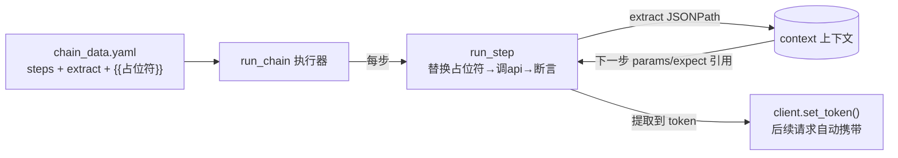

# 09 · 业务链路与变量提取（api-test-framework · 文档09）

> 一句话：登录→查商品→加购→下单→支付一条 YAML 跑到底——上下游变量自动提取、自动传递、失效自动重登。

## 1. 在整个框架中的位置

链路用例是框架的"编排层"能力，建立在数据驱动（docs/07）和 token 机制（docs/05）之上：



## 2. 涉及文件

| 文件 | 职责 |
|---|---|
| `data/chain_data.yaml` | 4 条链路用例（全链路/空购物车/取消回补/token 吊销重登） |
| `testcases/api_registry.py` | `run_chain` + `run_step` + `substitute`（占位符引擎在 data_loader） |
| `testcases/test_chain.py` | 15 行：parametrize + run_chain |

## 3. 如何实现

### 3.1 链路数据的结构

```yaml
- name: 全链路-登录查商品加购下单支付
  steps:
    - name: 登录主账号
      api: login
      params: { username: lemon, password: "123456" }
      expect: { code: 0 }
      extract: { token: $.data.token }        # ← 从响应提取变量存入上下文

    - name: 从购物车创建订单
      api: order_create
      params: { from_cart: true }
      expect: { code: 0 }
      extract: { order_id: $.data.order_id, order_no: $.data.order_no }

    - name: 查询订单详情核对明细
      api: order_detail
      params: { order_id: "{{order_id}}" }    # ← 占位符引用上一步提取的变量
      expect:
        fields:
          $.data.order_no: "{{order_no}}"     # ← expect 里也能引用（断言"就是我下的单"）
```

### 3.2 执行器的 60 行（完整逻辑）

```python
def run_step(client, step, context):
    with allure.step(step.get("name") or step["api"]):     # 报告里一步一折叠
        params = substitute(step.get("params") or {}, context)   # ① 替换 {{var}}
        expect = substitute(step.get("expect") or {}, context)   # ② expect 也替换
        resp = REGISTRY[step["api"]](client, params)             # ③ 调 api
        attach_response(resp)
        assert_response(resp, expect, context=step.get("name")) # ④ 每步断言

        for var, expr in (step.get("extract") or {}).items():    # ⑤ 提取变量
            value = extract_jsonpath(resp.json(), expr)
            if value is None:
                raise AssertionError(f"提取变量 {var} 失败：{expr} 未命中")
            context[var] = value
            if var == "token":                    # ⑥ 链路约定：token 立即注入
                client.set_token(value)
    return resp

def run_chain(client, case):
    context = {}                                  # 上下文：一条链路一个 dict
    for step in case["steps"]:
        run_step(client, step, context)
```

### 3.3 占位符替换的类型保持

```python
# common/data_loader.py
def substitute(obj, context):
    ...
    if isinstance(obj, str):
        match = _PLACEHOLDER.fullmatch(obj.strip())
        if match and match.group(1) in context:
            return context[match.group(1)]        # 整值替换：{{order_id}} → int 12
        return _PLACEHOLDER.sub(...)              # 内嵌替换：字符串拼接
```

为什么区分"整值"和"内嵌"：`order_id: "{{order_id}}"` 传给 api 后应该是 **int 12**
而不是字符串 "12"——服务端 `isinstance(goods_id, int)` 校验会拒绝字符串。

### 3.4 四条链路各自验证什么机制

| 链路 | 验证的机制 |
|---|---|
| 全链路（11 步） | 变量提取/传递、状态机（重复支付 4002、已支付不可取消）、下单后购物车清空 |
| 空购物车下单 | 反向链路：用从未使用的备用账号，保证"空购物车"确定性 |
| 直购取消库存回补 | 业务闭环：stock 100 → 下单 99 → 取消回补 100，两端断言 |
| token 吊销自动重登 | 401 → 钩子重登 → 自动重放（docs/05 的机制被真实触发） |

### 3.5 顺序依赖的确定性设计

pytest 按文件名字母序收集：`test_chain.py` 最先跑。每条链路**自我闭环**：
- 全链路结束时购物车清空（from_cart 下单自动清）→ 任何时刻重跑都成立；
- 直购链路结束时库存回补 → 不留状态垃圾；
- 空购物车用专用账号 test（全框架没人动它的购物车）。

这就是"链路可重复"的设计方法：**开头状态确定 + 结尾状态归位**。

## 4. 为什么这样设计

| 决策 | 备选方案 | 结论 |
|---|---|---|
| YAML 编排步骤（steps 列表） | 全用 Python 写链路 | 链路是"业务流程知识"不是代码逻辑，YAML 让不写代码的人也能维护业务流；执行器只有 60 行，复杂度可控 |
| 每步独立断言 | 只有最后一步断言 | 中间步骤失败要立刻停（后续步骤必然全错），且报错要指明是哪一步 |
| 提取的 token 自动注入 | 每步显式写 header | "登录→带鉴权"是所有链路的公共前缀，约定一次全链路生效 |
| 链路客户端独立于主客户端 | 共用 rest_client | 链路切账号/吊销 token 会污染主会话（真实踩坑：单步用例的 me 断言变成了 test 账号） |
| expect 也过占位符 | 只替换 params | 首版只替换 params，"核对订单号"断言拿字面量 "{{order_no}}" 去比，必然失败——这是开发中真实发生的 bug，修复后成了设计的一部分 |

**链路 vs 单步的分工哲学**：单步用例测"接口契约"（无状态、可并行），链路用例测"业务正确性"
（有状态、讲顺序）。两者混写是新手框架最常见的结构混乱。

## 5. 怎么运行/验证

```bash
cd D:\软件测试\api-test-framework

# ① 全链路用例（-v 看每步）
python -m pytest "testcases/test_chain.py" -v --reruns 0 2>&1 | tail -6
# 预期: 4 passed

# ② 验证变量真的传了：把查单步骤的 order_id 占位符删掉改成 99999
#    预期: 那一步断言 4001 失败——证明传参真实生效

# ③ 验证 token 注入：链路里注释掉 login 步骤的 extract 行
#    预期: cart_get 步骤 401——证明注入是自动的且必要
```

## 6. 常见坑

1. **上下文用全局变量**：两条链路并发/先后跑时变量互相覆盖——context 必须是每次 run_chain 新建的局部 dict。
2. **提取变量名与 api 参数名对不上**：extract 写 `orderId`，params 写 `{{order_id}}`——占位符替换静默不生效（找不到就保留原样），变成字符串 "99999" 传下去。本框架对"未命中"保留原样是**刻意的**（便于发现字面量），但替换失败要在断言报错里暴露。
3. **链路里混入破坏性操作不回滚**：比如链路最后库存少了、购物车脏了，导致同一套件重跑就红。闭环设计是纪律。
4. **中间步骤失败继续跑**：Python 异常自然中断 for 循环——不要 try/except 吞掉步骤失败。

## 7. 面试怎么讲

**30 秒版**：
"业务链路我在 YAML 里编排：一条用例是 steps 列表，每步可断言、可提取变量；
执行器 60 行——替换占位符、调 api、断言、按 JSONPath 提取存上下文。
两个关键约定：提取出的 token 立刻注入请求头，后续请求自动携带；
params 和 expect 都支持 {{占位符}}，所以'查单详情的订单号必须等于下单时返回的订单号'
这种上下游一致性断言也能写进数据文件。链路客户端独立，切账号不污染其他用例。"

**高频追问**：
1. *"下单依赖登录，这种上下游怎么处理？"* —— 两层：token 靠自动注入；业务 id 靠 extract+占位符。同业框架（如 httprunner）思路一致。
2. *"链路中途失败了怎么办？"* —— 断言异常立刻终止本链路，报告里能看到停在哪一步、当时的请求响应全文；后续用例不受影响（因为链路设计成闭环）。
3. *"为什么不用 pytest-dependency 这类插件？"* —— 用例间依赖会让失败传染、难并行；本框架把"依赖"降级为"链路内步骤顺序"，边界清楚。

## 8. 复现任务清单

- [ ] 1. 在 data_loader 写 substitute（整值保类型 + 内嵌替换）
- [ ] 2. 写 run_step：替换→调api→断言→提取→token 注入约定
- [ ] 3. 写 run_chain + test_chain.py（15 行）
- [ ] 4. 抄写"全链路"YAML 并跑通，观察 Allure 里的 step 折叠
- [ ] 5. 做 docs 里的三个验证实验（删占位符/删 extract 看报错）
- [ ] 6. 自己写一条新链路：注册新用户→登录→改资料（练习闭环设计）
