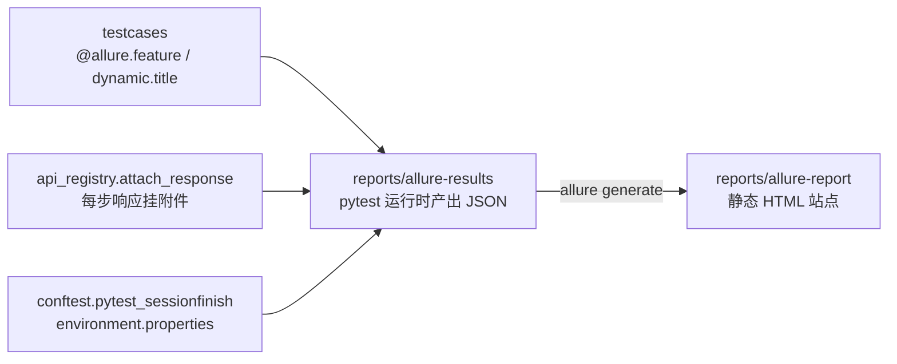

# 10 · Allure 报告与失败留痕（api-test-framework · 文档10）

> 一句话：报告是给"三个月后的人"看的——分层导航、用例标题、响应附件、环境面板，一个不少。

## 1. 在整个框架中的位置



## 2. 涉及文件

| 文件 | 职责 |
|---|---|
| `pytest.ini` | `--alluredir=reports/allure-results --clean-alluredir` |
| `testcases/api_registry.py` | attach_response()：每条用例的响应体挂进报告 |
| `testcases/conftest.py` | pytest_sessionfinish 写 environment.properties |
| `test_*.py` | @allure.feature 类级标注 + dynamic.title 用例标题 |

## 3. 如何实现

### 3.1 两个命令行工具的关系（新手必混淆点）

```bash
# ① pytest 只负责"产结果"（一坨 JSON，叫 results 不叫 report）：
python -m pytest                    # pytest.ini 里已带 --alluredir

# ② allure 命令行负责"结果 → 报告"：
allure serve reports/allure-results           # 临时起本地服务直接看
allure generate reports/allure-results -o reports/allure-report --clean
allure open reports/allure-report             # 打开静态站点
```

**results 是原料，report 是成品**：results 每次 pytest 都重新生成（--clean）；
report 只有你执行 generate 才更新。CI 里由 Jenkins 的 Allure 插件做第②步。

### 3.2 报告里每一个可读性细节的来源

| 报告里看到 | 代码里的来源 |
|---|---|
| Behaviors 页按"登录模块/商品模块"分组 | `@allure.feature("登录模块")` 类级装饰器 |
| 用例显示中文全名 | `allure.dynamic.title(case["name"])`（执行器里设） |
| 每条用例展开有"响应报文"附件 | `allure.attach(resp.text, attachment_type=JSON)` |
| 链路用例能看到步骤折叠树 | `with allure.step(step["name"])` |
| 首页 Environment 显示 base_url/python 版本 | conftest 写 environment.properties |
| 失败用例的断言全文 | assert_response 的多行 AssertionError（无需额外处理） |

### 3.3 附件挂载的实现

```python
def attach_response(resp, name="响应报文"):
    allure.attach(resp.text, name=name, attachment_type=allure.attachment_type.JSON)
```

挂在每个 run_single_case/run_step 里——**执行器统一挂**，手写用例自动继承这个福利。

### 3.4 链路的 step 折叠

```python
with allure.step(step.get("name") or step["api"]):
    ...调接口、断言、提取...
```

with 块里发生的一切（请求、断言、附件）都归到这个 step 下——报告里
"全链路"用例展开是一棵 11 步的树，每步独立看响应。

## 4. 为什么这样设计

| 决策 | 备选方案 | 结论 |
|---|---|---|
| Allure 而非 pytest-html | pytest-html / html-report | Allure 有 Behaviors 分层、history 趋势、环境面板、附件体系——是"报告平台"不是"一张 html"；也是 JD 高频词 |
| 标题用中文用例名 | 默认函数名 | 报告是给产品/QA/老板看的，"test_goods_api[关键字命中一件商品]"可读性天壤之别 |
| 响应体每用例都挂 | 只在失败时挂 | 本地调试时成功用例的响应也有排查价值；失败现场另有断言全文兜底 |
| feature 按"业务域" | 按"文件名" | 与 api 层业务域对齐，报告与代码结构互相印证 |

## 5. 怎么运行/验证

```bash
cd D:\软件测试\api-test-framework
python -m pytest                                   # 产 results
allure generate reports/allure-results -o reports/allure-report --clean
allure open reports/allure-report                  # 浏览器打开 http://x.x.x.x:port
```

验收清单（逐项在报告里核对）：
- [ ] Overview 页 Environment 显示 base_url=http://127.0.0.1:5000
- [ ] Behaviors 页有 登录模块/商品模块/购物车模块/订单模块/业务链路 五个分组
- [ ] 随机打开一条用例，附件区有"响应报文"
- [ ] 打开"全链路"用例，有 11 个步骤的折叠树
- [ ] 故意改错一个期望值重跑，失败详情里能看到断言全文 + 请求响应

## 6. 常见坑

1. **`allure: command not found`**：Allure 是 Java 工具，要单独装（本机已装在
   `C:\Users\37535\tools\allure-2.30.0`，已加入用户 PATH，**新开终端**生效）。
2. **报告打开是空的/旧的**：generate 前没跑 pytest（results 不存在）或忘了 --clean（新旧混杂）。
3. **results 目录进 git**：几十 MB 的 JSON  pollution——.gitignore 已配。
4. **pytest 装了 allure-pytest 但报告里没有 title**：dynamic.title 必须在用例函数体内调用（本框架在 run_single_case 里调）。
5. **Windows 中文乱码**：generate 时结果 JSON 是 UTF-8，浏览器正常；若用旧版 cmd 打开日志文件乱码是编码显示问题，与报告无关。

## 7. 面试怎么讲

**30 秒版**：
"Allure 集成我做了四件事：类级 feature 让报告按业务域分层导航；
执行器里 dynamic.title 让用例显示中文全名；每个请求的响应体自动挂附件，
链路用例还有步骤折叠树；conftest 在会话结束时把 base_url/环境写进
environment.properties，报告自证测试环境。失败用例不用额外处理——
断言失败信息本身带了请求响应全文，直接进报告。"

**高频追问**：
1. *"Allure 和 pytest 是什么关系？"* —— pytest 产 results（JSON 原料），allure 命令行把原料渲染成报告；pytest.ini 的 --alluredir 指定原料目录。
2. *"怎么在报告里看请求体？"* —— 响应附件 + 失败断言全文都有；请求体在断言详情的"请求"段。
3. *"报告的历史趋势怎么做？"* —— Allure history：保留上次的 history 目录拷进新 results 再 generate，报告会显示通过率趋势（Jenkins 插件自动做，S14 实操）。

## 8. 复现任务清单

- [ ] 1. 安装 allure 命令行并 `allure --version` 验证
- [ ] 2. pytest.ini 配 --alluredir + --clean-alluredir
- [ ] 3. 类级 @allure.feature + 执行器里 dynamic.title + attach_response
- [ ] 4. conftest 写 environment.properties
- [ ] 5. 跑完整套件 → generate → 按上面验收清单逐项核对报告
- [ ] 6. 制造一次失败，确认报告里的失败详情包含请求响应全文
