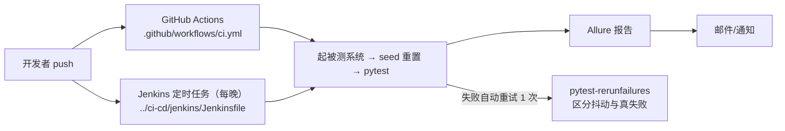

# 11 · 工程化收尾与 CI（api-test-framework · 文档11）

> 一句话：失败自动重试、提交自动回归、报告自动发布——从"本地能跑"到"企业能收"的最后三公里。

## 1. 在整个框架中的位置



## 2. 涉及文件

| 文件 | 职责 |
|---|---|
| `pytest.ini` | `--reruns 1 --reruns-delay 1` |
| `.github/workflows/ci.yml` | GitHub Actions：push/PR 自动回归 |
| `../ci-cd/jenkins/Jenkinsfile` | Jenkins 声明式流水线（定时 + 报告 + 邮件） |
| `README.md` | 面试官点进 GitHub 看到的第一眼 |

## 3. 如何实现

### 3.1 失败自动重试（pytest-rerunfailures）

pytest.ini：`--reruns 1 --reruns-delay 1`。

**重试解决什么、不解决什么**（这是面试的正确答案）：

| 用例类型 | 重试的价值 |
|---|---|
| 环境/网络抖动（超时、偶发 5xx） | ✅ 消除假失败，报告可信度↑ |
| 数据竞争（并行跑） | ⚠️ 治标不治本，该修数据隔离 |
| 断言性失败（期望值写错/bug） | ❌ 重试 100 次也红，红的才有价值 |

报告里 RERUN 状态会显式标出——**红是真红，绿要警惕是重试救回来的**。

### 3.2 GitHub Actions（.github/workflows/ci.yml）

核心步骤（完整文件见该 yml，带逐行注释）：

```yaml
- checkout 本仓库 + checkout demo-mall 仓库（被测系统）
- setup-python 3.13 → pip install
- 后台启动 demo-mall → 轮询 /api/health 等就绪
- python seed.py --reset          # 被测系统数据就位
- pytest --alluredir=reports/allure-results
- upload-artifact 收集 allure-results
```

CI 里跑测试的**环境三件套**：起被测系统 → 等健康检查 → 重置数据。
本地/CI 行为一致的原因：被测系统自带 seed + reset，这正是 demo-mall 设计的回报。

### 3.3 Jenkins（../ci-cd/jenkins/Jenkinsfile）

声明式流水线：Checkout → Python venv → 重置数据 → pytest → Allure 报告发布 → 邮件通知。
触发方式：`cron('H 23 * * *')` 每晚自动回归（H 表示 Jenkins 自动分散负载）。
详细搭建步骤在 `../ci-cd/docs/02-Jenkins安装与配置.md`。

### 3.4 README 的工程化标准

面试官 clone 你的仓库，30 秒内要能回答三个问题：
1. 这是什么？（项目简介 + 架构图）
2. 怎么跑起来？（三步命令，可复制粘贴）
3. 值得看哪里？（目录表 + 文档索引 + 用例统计）

本仓库 README 逐条满足；"换台电脑按 README 复现"是 S8 的正式验收项，**真做一遍**。

## 4. 为什么这样设计

| 决策 | 备选方案 | 结论 |
|---|---|---|
| Actions + Jenkins 两套都配 | 只配 Jenkins | Jenkins 是 JD 高频要求且 S14 要学；Actions 让 push 即有 CI 反馈（不依赖本地 Jenkins 环境）——学习期/求职期都有东西可演示 |
| 重试 1 次 | 重试 3 次+ | 重试是抖动缓冲不是遮羞布；1 次足以区分"偶发"与"稳定失败" |
| CI 里跑全量 | CI 跑 smoke | 每晚定时跑全量（58 条 <1 分钟，毫无压力）；PR 时可只跑 smoke（加 stage 条件即可） |
| 报告产物不入 git | 把 html 报告 commit | 产物走 CI 的 artifact/报告插件；git 里只有源码和文档 |

## 5. 怎么运行/验证

```bash
# 本地验证重试机制：故意造一个偶发失败太麻烦，用 --reruns 手动验证逻辑
cd D:\软件测试\api-test-framework
python -m pytest testcases/test_login.py --reruns 2 -v 2>&1 | tail -3

# 验证 CI 配置语法（本地有 docker 时）：
# docker run --rm -v "$(pwd)":/repo -w /repo cytopia/yamllint .github/workflows/ci.yml

# push 后到 GitHub 仓库 Actions 页看绿勾（需要先把 demo-mall push 为
# rain207988/demo-mall，S0 的 SSH 配置完成后操作）
```

## 6. 常见坑

1. **CI 里被测系统没起就跑用例**：`/api/health` 轮询是必须步骤，sleep 固定秒数不可靠。
2. **CI 依赖了本地路径**：`D:\软件测试\...` 硬编码在脚本里——CI 用相对路径 + 环境变量。
3. **重试掩盖真问题**：rerunfailures 默认全用例重试；企业实践是只对网络类用例加 `@flaky` 标记重试，本项目规模小用全局 1 次，规模大了要收敛。
4. **Jenkins 里 Python 找不到**：容器内要装 python + venv，或用已装好的 agent；见 ci-cd 文档。
5. **邮件发不出去**：SMTP 需要授权码不是登录密码（QQ/163 邮箱都如此）——这是 Jenkins 邮件配置第一大坑。

## 7. 面试怎么讲

**30 秒版**：
"工程化收尾三件事：一是 pytest-rerunfailures 失败自动重试 1 次，把网络抖动和
真失败区分开，报告里 RERUN 状态一目了然；二是 CI——GitHub Actions 在 push 时
自动起被测系统、重置数据、跑回归、归档 Allure 结果，Jenkins 做每晚定时回归
加报告和邮件，被测系统自带 reset 接口让本地和 CI 行为完全一致；
三是 README 按'面试官 30 秒三问'的标准写的，换台电脑真能照着跑通。"

**高频追问**：
1. *"定时构建的 cron 怎么写？"* —— Jenkins `H 23 * * *`（每晚 23 点附近，H 由 Jenkins 均衡）；经典 `0 23 * * *` 也行。
2. *"重试会不会掩盖 bug？"* —— 会，所以只重试 1 次 + 报告显式标 RERUN + 复盘时把 RERUN 用例当"待观察"处理。
3. *"你们的 CI 流程画一下？"* —— push/定时 → 拉代码 → 装环境 → 起被测系统 → 健康检查 → 重置数据 → pytest → Allure → 邮件通知；每一步都在 Jenkinsfile 里能指出来。

## 8. 复现任务清单

- [ ] 1. pytest.ini 加 --reruns 1，故意制造一次失败观察 RERUN 状态
- [ ] 2. 通读 .github/workflows/ci.yml，能在纸上画出 8 个步骤
- [ ] 3. （S14 时）按 ci-cd 文档搭 Jenkins，跑通"push→自动回归→邮件"
- [ ] 4. 把 README 按三问标准改写成自己的版本
- [ ] 5. 换台电脑（或删 venv）按 README 从零复现一次——S8 的正式验收
